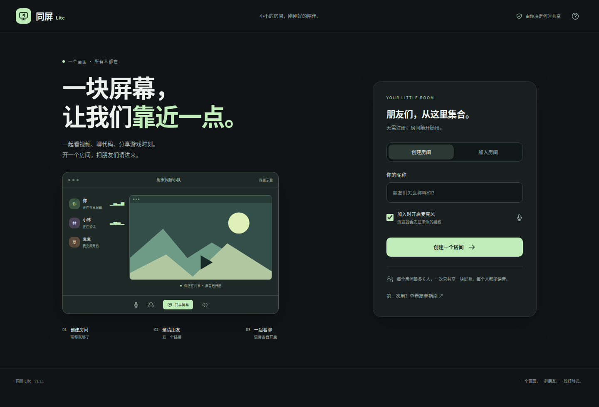
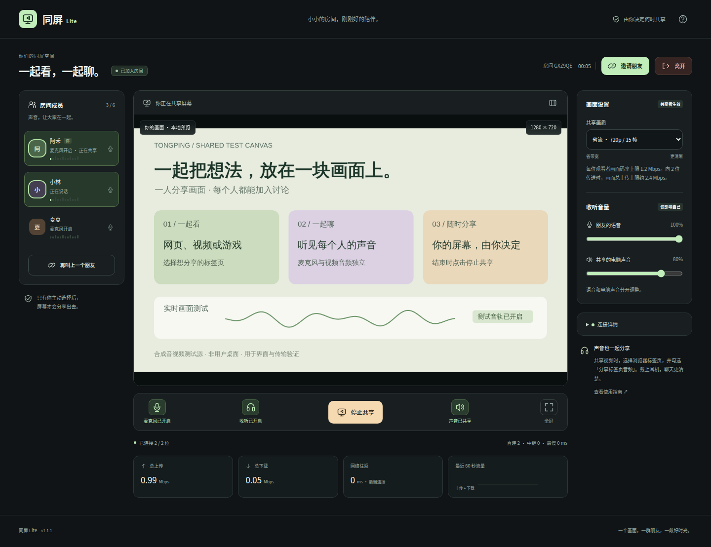

# 同屏 Lite

**一人共享屏幕，所有人一起语音。** 可以托管在自己的 Linux 服务器上，用浏览器加入，不需要注册账号，也不需要购买屏幕共享会员。

本项目适合小群体：默认每个房间最多 **6 人**，可配置为 2–16 人。首版采用 WebRTC 直连网状连接，信令服务不接收音视频、不保存通话或屏幕内容。跨网无法直连时，可使用自己的 coturn 中继。

> 默认画质为 720p / 15 帧，每位观看者画面码率上限 1.2 Mbps。多人观看时，共享者需要分别向每个人发送画面。此版本没有实现 SFU 的“只上传一份、服务器分发多份”；配置人数上限也不等于已验证相同人数下的媒体性能。

## 真实浏览器测试图

下面图片由 GitHub Actions 中的真实 Chromium 渲染截图。房间有三位浏览器参与者；画面使用明确标注的合成测试源，验证实际 WebRTC 接收与界面，并非用户桌面。





[观看端、专注模式和手机截图](docs/SCREENSHOTS.md) · [浏览器验证记录](docs/images/summary.json)

## 已实现

- 应用式可视化界面：左侧成员、中间共享画面与通话操作、右侧画质与音量；支持手机布局和专注模式。
- 实际语音电平与说话高亮，逐成员连接提示，以及总上传、下载、往返时间和最近一分钟流量趋势。
- 朋友语音与共享电脑声音两套音量；可暂停本机收听，不中断自己的麦克风发送。
- PWA 桌面安装：在支持安装的 Chrome / Edge 中以独立窗口打开，保留浏览器的共享与麦克风授权。
- 一个房间内多人同时语音，一个人共享屏幕，其余人观看。
- 服务端控制共享权，防止两个正常客户端同时开始；停止或离开后可换人共享。
- 共享标签页、窗口或整个屏幕，由浏览器的选择窗口决定。
- 麦克风语音与共享的电脑声音使用独立音轨；关闭麦克风不会关闭电影声音。
- 语音请求浏览器回声消除、降噪和自动增益；关闭语音时停止本地麦克风采集。
- 邀请链接、昵称、成员列表、麦克风状态、共享状态。
- 4 档画质，发送端执行码率与帧率上限，并显示实际码率、分辨率、网络往返时间和直连/中继数量。
- 断线重连、ICE 重试、房间人数上限与有效期。
- Docker + Caddy 自动 HTTPS，另提供现有 Nginx 反向代理配置和可选 coturn。
- Python 服务端和原生 HTML/CSS/JavaScript；无数据库、无生产前端构建、无运行时 CDN 脚本。

## 1. 本机试用

需要 Python 3.10 或以上。Windows 用户可用 Python 或 Anaconda，Linux/macOS 用 `python3`。

```bash
python -m venv .venv
```

Windows PowerShell：

```powershell
.venv\Scripts\Activate.ps1
python -m pip install -r requirements.txt
python server.py
```

Linux/macOS：

```bash
source .venv/bin/activate
python -m pip install -r requirements.txt
python server.py
```

打开 **http://localhost:8080**。输入昵称、创建房间，复制完整链接。可以先在同一台电脑的两个浏览器窗口里试用；同机多窗口语音建议戴耳机或只开一个麦克风。

### 像软件一样安装到桌面

用电脑 Chrome / Edge 打开部署后的 HTTPS 地址。浏览器满足安装条件时，顶部会出现「安装到桌面」按钮；也可以从浏览器菜单中选择安装应用。安装后有独立窗口和桌面入口，仍使用同一服务器、同一房间链接，不需单独安装 Python。应用安装能力取决于浏览器；它是 PWA，不是 Windows `.exe` 安装包。

应用外壳可以缓存；语音、屏幕共享和房间操作必须联网。服务端 API、信令、邀请房间路径均不进入应用缓存。界面使用方法见 [界面指南](docs/INTERFACE.md)。

**HTTP 的局域网 IP 地址不能代替 localhost。** 要从另一台设备访问，需先配置 HTTPS。

## 2. 个人服务器部署（Docker）

准备：Linux 服务器、Docker Engine + Compose 插件、一个域名。将域名 A/AAAA 记录指向这台服务器，开放 TCP 80、443。服务器若不能提供 IPv6 服务，不要保留错误的 AAAA 记录。

在服务器下载项目并进入目录。下面的 `share.example.com` 必须换成你的域名：

```bash
git clone https://github.com/Changhooo/closer.git
cd closer
python3 scripts/configure.py share.example.com
docker compose up -d --build
```

脚本会生成 `.env` 和随机创建房间口令，不覆盖已存在的 `.env`。创建房间时填写 `.env` 中的 `ACCESS_KEY`；受邀者持有完整邀请链接即可加入，无需另外知道创建口令。

访问 `https://share.example.com`。Caddy 会申请并续期证书。首次申请期间页面可能尚未就绪，可查看运行状态：

```bash
docker compose ps
docker compose logs --tail=100 app caddy
```

成功后可通过 `https://你的域名/healthz` 检查服务，返回 `status: ok`。默认配置中，应用 8080 端口只在 Docker 内部使用，不对外开放。

**服务器已使用 80/443 端口：** 不要再启动本项目 Caddy。使用已有 HTTPS 反向代理，参考 [Nginx 示例](deploy/nginx.conf.example)。裸 Python 服务默认只监听 `127.0.0.1:8080`，设置 `PUBLIC_ORIGIN=https://你的域名` 后启动；自行托管 Docker 时只把应用端口映射到宿主机 `127.0.0.1`。代理必须支持 WebSocket。生产不要同时启动多个独立 Python 实例：房间状态目前只在单进程内存中。

## 3. 跨网络连接：增加 TURN 中继

网页能打开、成员能加入，却连不上语音或画面，可能是双方 NAT 或防火墙阻止直连。单独增加信令服务器带宽无法解决这个问题，需要可达的 TURN 中继。

推荐在同一台 Linux 服务器配置 coturn。为 `turn.example.com` 配置 DNS，并开放：

| 用途 | 端口 |
| --- | --- |
| HTTPS 网站 | TCP 80、443；UDP 443 为可选 HTTP/3 |
| TURN/STUN 监听 | UDP 与 TCP 3478 |
| TURN 媒体中继 | UDP 49160–49200 |

首次配置时：

```bash
python3 scripts/configure.py share.example.com --turn-host turn.example.com --turn-ip 203.0.113.10
docker compose -f compose.yml -f compose.turn.yml up -d --build
```

`203.0.113.10` 是文档示例地址，**必须替换成服务器实际公网 IP**。该可选方案用 Linux host network；不能直接照搬到 Docker Desktop。所有后续管理命令也要带上同样的两个 `-f` 参数。

已有 `.env` 时，手动补齐以下内容，`TURN_SECRET` 用足够长的随机字符串：

```dotenv
TURN_DOMAIN=turn.example.com
TURN_PUBLIC_IP=你的服务器公网IP
TURN_URLS=turn:turn.example.com:3478?transport=udp,turn:turn.example.com:3478?transport=tcp
TURN_SECRET=自己生成的长随机字符串
STUN_URLS=stun:turn.example.com:3478
```

信令服务与 coturn 使用相同的 `TURN_SECRET`；浏览器仅在通过房间验证后收到带有效期的临时 TURN 凭证，收不到共享密钥。`turn:` 上的连接信令不是 TLS；WebRTC 音视频仍使用 DTLS/SRTP 加密。要求 TURN over TLS 或 UDP 完全被阻断的环境，需要单独配置 coturn 的 TLS 和监听端口。

可以暂时设置 `.env` 中 `RELAY_ONLY=true`，重启服务后用新房间检查中继是否正常；连接信息应显示中继。确认后恢复为 `false`，让客户端优先直连。

如果 VPS 实际网卡地址与公网地址不同，按 coturn 的 `external-ip` 公网/私网映射规则修改 `TURN_PUBLIC_IP`。服务器、运营商或安全组阻止 UDP 时，即使 HTTP 页面正常，也可能仍然没有媒体。

## 4. 使用方法与兼容性

1. 创建房间，复制**完整**邀请链接，发给朋友们。
2. 每个人输入昵称并加入，按需要开启自己的麦克风。
3. 一位成员点击「共享屏幕」，在浏览器弹窗里选择画面。
4. 要共享视频声音，在 Chrome/Edge 中选标签页并勾选「分享标签页音频」。
5. 共享者可以独立静音电脑声音；观看者分别调节「朋友的语音」和「共享的电脑声音」。点击耳机按钮暂停本机收听；自己的麦克风仍按原状态发送。
6. 停止共享后，另一位成员可以开始共享。离开会停止本地麦克风和屏幕采集。

推荐电脑端近期 Chrome / Edge。系统声音捕获取决于浏览器、操作系统与所选画面，`audio: true` 无法强制获得声音。没有音轨时页面会明确提示。部分移动浏览器可以观看和语音，却不支持从浏览器共享手机屏幕。本项目不绕过 DRM、系统权限或浏览器共享限制。

浏览器禁止自动播放时会显示「点击接通声音」。当前不提供摄像头、录制、远程控制、文件传输、持久聊天室或账号系统。

共享整个桌面的系统声音可能再次捕获本房间播放的语音，造成回声。首版浏览器模式不能保证像原生客户端一样排除特定进程声音；观看视频时优先只共享视频标签页音频。

## 5. 网络与服务器资源

先看共享者的**实际上传速度**和线路稳定性。采用当前直连模式时，`总画面上传 ≈ 每份实际码率 × 观看人数`，还需留出多人语音、协议开销和波动余量。

| 档位 | 目标画质 | 每位观看者画面码率上限 | 5 位观看者的画面上传上限 |
| --- | --- | ---: | ---: |
| 省流（默认） | 720p / 15 帧 | 1.2 Mbps | 6 Mbps |
| 均衡 | 720p / 30 帧 | 2 Mbps | 10 Mbps |
| 清晰 | 1080p / 30 帧 | 3.5 Mbps | 17.5 Mbps |
| 流畅 | 1080p / 60 帧 | 6 Mbps | 30 Mbps |

这些是代码中的发送上限，不是最低带宽需求，也不是画质保证；静态内容通常用得更少。发送端采用 WebRTC 拥塞控制，弱网会降低实际帧率或清晰度。多人语音也是网状连接，每人向其他人发送自己的语音。

**纯信令部署**可以先从 1 核 / 512 MB–1 GB 内存的个人服务器尝试，这只是起步配置建议，未进行该规格的容量实测。**启用 TURN** 后，服务器要承载中继流量。例如 5 位观众、每份 1.2 Mbps 的画面全部走中继，需要约 6 Mbps 出站画面带宽，另加语音、协议开销和余量。5 Mbps 出站的小服务器不能据此保证稳定 6 人共屏。

经常超过 6 人、分享者上传有限，或需要更多高清观看者时，建议扩展为 SFU：分享者上传一份媒体，由服务器向观看者分发。它能减少分享者上传，但会增加服务器出站流量和媒体服务维护。首版没有声称已具备这项能力。

## 6. 配置

| 变量 | 默认 / 含义 |
| --- | --- |
| `HOST`、`PORT` | 裸机 `127.0.0.1:8080`；Docker 内 `0.0.0.0:8080` |
| `PUBLIC_ORIGIN` | 正式访问源，例如 `https://share.example.com`；Compose 根据域名生成 |
| `ACCESS_KEY` | 创建房间口令；为空表示不限制创建，公网个人部署建议设置 |
| `MAX_PARTICIPANTS` | 6；范围 2–16 |
| `MAX_ROOMS` | 200；只是内存房间上限，非媒体容量承诺 |
| `MAX_CONNECTIONS` | 450；WebSocket 连接上限 |
| `ROOM_TTL_SECONDS` | 21600，即房间最长 6 小时 |
| `IDLE_TTL_SECONDS` | 1800，即空房间保留 30 分钟 |
| `STUN_URLS` | 默认公共 Cloudflare STUN；可改自己的 STUN，逗号分隔 |
| `TURN_URLS`、`TURN_SECRET` | 两者同时设置，或同时留空 |
| `RELAY_ONLY` | `false`；`true` 仅用配置的 TURN 中继 |
| `TRUSTED_PROXIES` | 默认空；裸机高级配置只信任明确指定的直连代理 IP |

服务器验证 WebSocket/创建请求的 Origin，只向本房间内的指定成员转发信令。服务对创建和连接做限速；未指定可信代理时，代理后的客户端共用代理 IP 的限速窗口。邀请链接的钥匙放在 `#key=` 片段里，不随 HTTP 请求发送；分享完整链接就相当于授权加入。`.env`、真实口令和日志不要提交到 GitHub。

房间、昵称、共享状态仅存在内存中；服务器重启后需创建新房间。浏览器只记住本机昵称，不持久化房间钥匙。建立 P2P 连接会向通信对方暴露可用于连接的网络地址；需要经中继隐藏直连地址时可以设置 `RELAY_ONLY=true`。

## 7. 验证与开发

生产只需要 `requirements.txt`，不用安装 Node.js。开发测试需要 Python、Node.js 24：

```bash
python -m pip install -r requirements-test.txt
npm ci --ignore-scripts
npm run check
npm test
python -m unittest discover -s tests -v
```

测试包括服务端人数限制、共享争抢与让出、房间隔离、邀请钥匙、过期清理、TURN 临时凭证、前端多人连接与媒体清理，以及 3 个 aiortc 客户端通过信令服务在回环网络建立的真实 ICE/DTLS/SRTP 音视频传输。

**验证边界：** DOM 控制测试采用模拟采集对象；真实媒体集成测试采用合成声波与移动图案。它们不等于 Windows 浏览器桌面捕获或跨运营商实测。Docker 配置已提供，当前开发环境未运行 Docker。部署后请按 [验收清单](docs/ACCEPTANCE.md) 用实际浏览器验收；详细已执行结果见 [验证记录](docs/VALIDATION.md)。

## 8. 参考项目和许可证

本项目借鉴多个开源项目的设计，采用独立实现。查看 [调研与整合记录](docs/REFERENCES.md)，其中记录具体源文件、检视提交和已经实现／暂未实现的边界。

- [Piik](https://github.com/TNTcraftHIM/Piik)：分享者和观看者分工、路由状态及媒体质量观测。
- [Weblink](https://github.com/99percentpeople/weblink)：声音分离、采集生命周期、发送参数与连接状态。
- [MiroTalk P2P](https://github.com/miroslavpejic85/mirotalk)：多人连接和定向信令组织。

项目源码以 [MIT](LICENSE) 发布。本仓库未直接复制 MiroTalk 的 AGPL 源文件，也未引入 Piik/Weblink 的原生采集库。它不是以上项目的官方分支，也不保证具备它们所有平台、编解码器、原生采集和 SFU 能力。

## 9. GitHub 与更新

源码仓库：[Changhooo/closer](https://github.com/Changhooo/closer)。包含 GitHub Actions 配置，在提交和拉取请求时执行自动检查及应用 Docker 镜像健康检查。可到仓库的 Actions 页面查看结果。

服务器已有部署时，在项目目录更新：

```bash
git pull --ff-only
docker compose up -d --build
```

使用 coturn 覆盖配置的部署，第二条命令要改为 `docker compose -f compose.yml -f compose.turn.yml up -d --build`。`.env` 不进入 Git，不会被更新覆盖。应用重建后，已有内存房间会结束，需要创建新房间。

GitHub 提供代码存储和 CI；应用仍部署在你的个人服务器。GitHub Pages 只能托管静态文件，不能运行这个 Python/WebSocket 服务。
