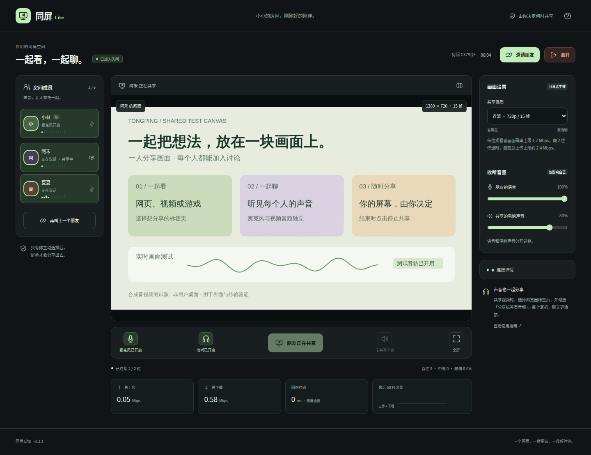
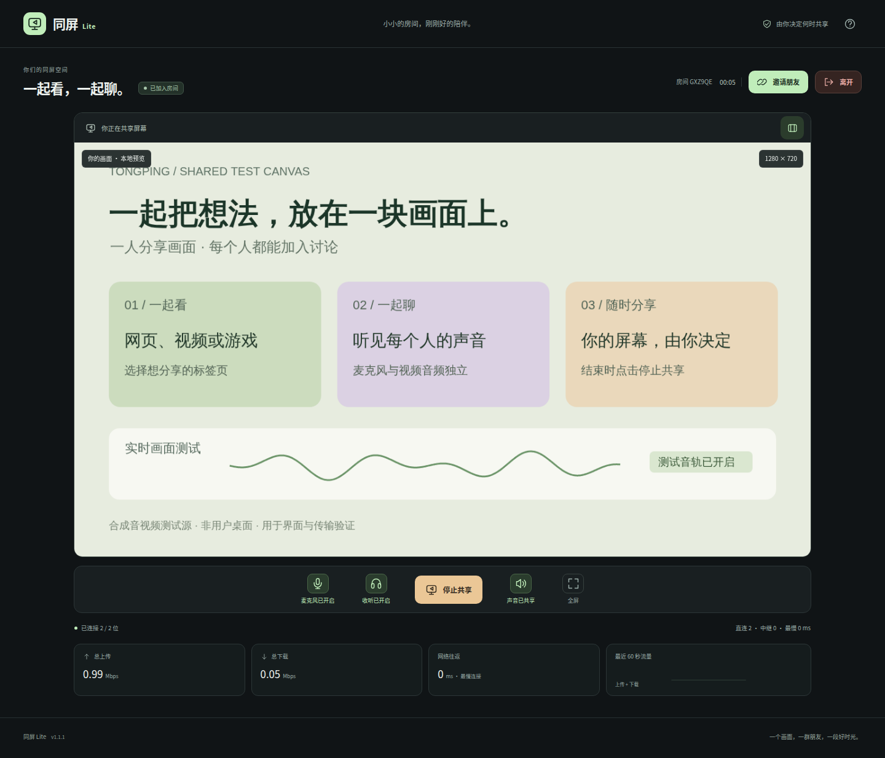
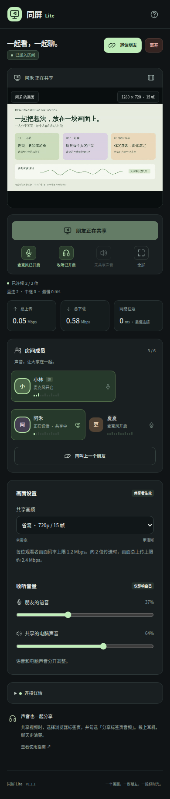
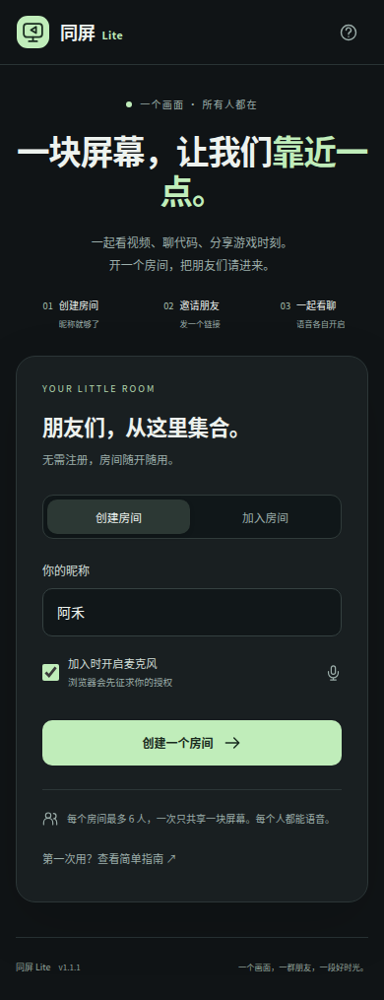

# 实际浏览器测试截图

图片在 GitHub Actions 的 Chromium 浏览器中生成，直接运行本项目服务器与界面。有三位独立浏览器参与者，测试画面是带明确标注的 Canvas 和测试声音，麦克风使用 Chromium 的测试设备。没有替换 API、信令、WebRTC、成员状态或页面 UI。

## 大厅（电脑）


## 三人语音与共享（分享者）


## 同一个房间（观看者）



观看者实际接收并解码共享视频。看到「朋友正在共享」时，共享按钮禁用，停止后恢复。

## 专注模式



## 手机宽度

以下是 Chromium 的 390 像素宽度布局，属于手机视口模拟，不是手机实机测试。





## 验证内容与复现

详细结果、浏览器版本与源码提交见 [summary.json](images/summary.json)。浏览器验证包含三人连接、六个麦克风传输方向、共享视频真实解码、音量与收听控制、语音电平、专注模式、静音后保持画面与共享声音、换人共享、320–1440 像素窗口宽度、PWA 清单及服务工作线程。

本机需要 Python 和 Playwright 浏览器依赖，可以执行：

```bash
pip install -r requirements-browser.txt
python -m playwright install --with-deps chromium
python scripts/browser_screenshots.py --output-dir test-results
```

脚本自动启动只监听本机的测试服务器，结束后关闭。截图和检查结果在 `test-results/`；CI 每次相关源码变更都会生成同名 artifact。Linux 缺少中文字体时需安装字体，例如 Ubuntu 的 `fonts-noto-cjk`。

本测试不覆盖 Windows/macOS 的系统分享选择窗口、真实麦克风、PWA 安装向导、不同运营商或 TURN 中继；这些仍按 [设备验收清单](ACCEPTANCE.md) 检查。
